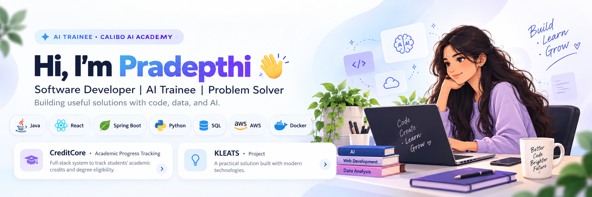

 

### 💻 SOFTWARE DEVELOPER • AI TRAINEE • TECH ENTHUSIAST

*Building useful solutions with code, data, and AI.*

---

## 👩‍💻 About Me

Hi! I'm **Pradeepthi**, a B.Tech student passionate about software development, artificial intelligence, and cloud technologies.

- 🚀 Currently an **AI Trainee at Calibo AI Academy**
- 🤖 Exploring Generative AI, Python, SQL, EDA, and Docker
- 💡 Building projects to solve real-world problems
- ☁️ AWS Certified Developer – Associate
- 🌱 Always learning, building, and improving my technical skills

---

## 🎓 Profile & Highlights

| 🎓 Profile | 📈 Highlights |
|---|---|
| B.Tech Student | AWS Certified Developer – Associate |
| Software Development | Calibo AI Academy Trainee |
| Java & Full-Stack Development | AI and Data Analysis Learning |
| Cloud & AI Enthusiast | Academic and Web Applications |

---

## 🛠️ Tech Stack

---

## 💼 Experience

### 🟢 AI Trainee — Calibo AI Academy

Developing practical skills in artificial intelligence, data analysis, SQL, and software engineering through structured training and hands-on assignments.

**Learning focus:**
- 🤖 Generative AI and Large Language Models
- 🐍 Python, NumPy, and Pandas
- 📊 Exploratory Data Analysis and visualization
- 🗄️ SQL and data-driven problem-solving
- 🔧 Git, GitHub, and Docker
- 💡 Applying technical concepts to real-world use cases

---

## 🚀 Featured Projects

### 🎓 CreditCore — Academic Progress Tracking System

A full-stack academic tracking platform designed for KL University's DYOD curriculum.

- Tracks academic credits and degree requirements.
- Supports academic auditing and graduation eligibility checks.
- **Tech:** Java 21, Spring Boot, React, JWT, and AI-based features.

### 💡 KLEATS

A project I'm developing and looking forward to showcasing.

- Add the project's purpose and key features here.
- Add the actual technologies used in the project.

### ☕ Roast & Brew

A responsive coffee shop website with a modern interface.

- **Tech:** HTML, CSS, JavaScript.

### 🌦️ Weather App

A weather application that retrieves weather information using an API.

- **Tech:** HTML, CSS, JavaScript, Weather API.

### ⏱️ Stopwatch Web App

An interactive stopwatch with start, pause, reset, and dark mode functionality.

- **Tech:** HTML, CSS, JavaScript.

---

## 🏆 Certifications

- ☁️ AWS Certified Developer – Associate
- 🌐 Cisco Networking Essentials

---

## 📊 GitHub Statistics

---

### ✨ Build • Learn • Create • Repeat

*Thanks for visiting my profile! Let's connect and build something meaningful.*

